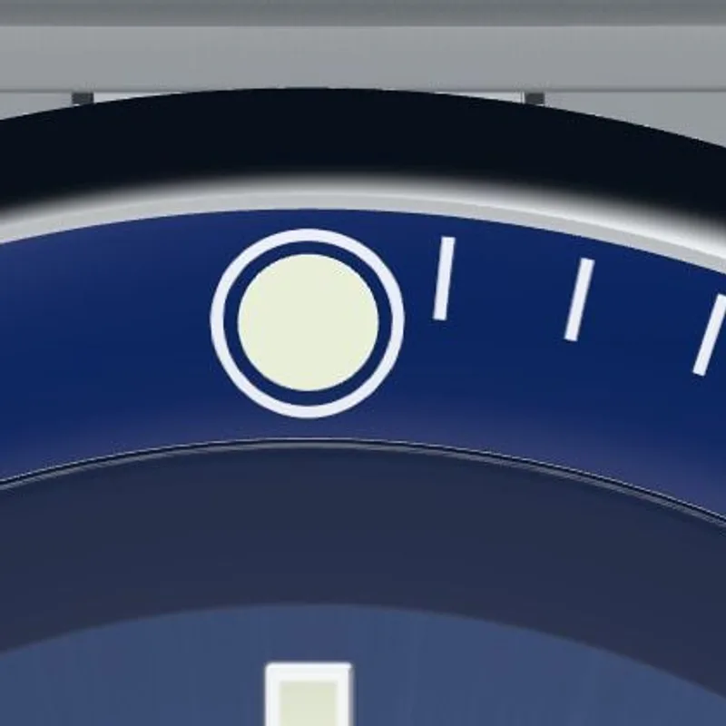
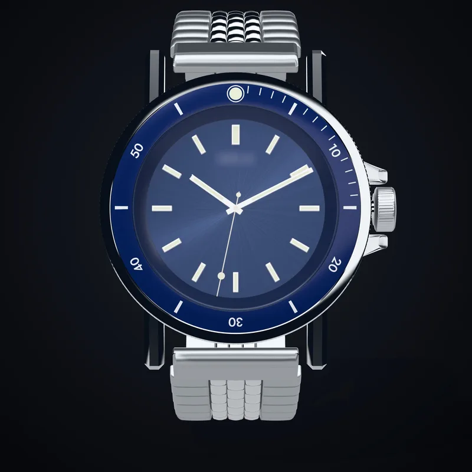

# ⌚🔍 WatchCrop

A daily "guess the watch" game for people who recognize a watch at a glance.
One watch a day starts zoomed all the way in (a crown, a handset, a bezel pip)
with the logos hidden, and zooms out every time you miss. Name the brand and
the model before it's fully revealed.

**▶ [Join the waitlist →](https://watchcrop.vercel.app)** — the site is in its
waitlist phase; the game switches on once demand is proven.

<p align="center">
  
  
  
</p>
<p align="center"><sub>Crops 1, 3 and 6 of a sample round: an original 3D watch, cut by the same pipeline as real puzzles.</sub></p>

The hard part of a daily game isn't the code. It's feeding it a new puzzle
every day, and here every puzzle is a photograph someone owns. So the repo
ships in **two phases from one codebase**, and the expensive part waits until
the cheap test says people want it.

## Two phases, one codebase

1. **Phase 0, the waitlist (live now).** With `NEXT_PUBLIC_GAME_LIVE=false`
   the public sees a landing page with a waitlist form, and `/play` says the
   game isn't live yet. A tracked affiliate redirect (`/go/[ref]`) and the
   admin **Demand** panel measure real interest and real affiliate earnings
   before any photo library is built.
2. **The game phase.** Flip `NEXT_PUBLIC_GAME_LIVE=true` and the daily game
   at `/play` goes live; the landing page swaps the form for a **Play** button.

> [!NOTE]
> The gate between them: the game stays off until the waitlist and a manual
> daily show a credible path past ~1k daily players. The playbook is in
> [docs/ROADMAP.md](docs/ROADMAP.md), the reasoning in [docs/RISKS.md](docs/RISKS.md).

## Features

| Feature | What you get |
| --- | --- |
| **Six crops** | Extreme macro to the whole watch, logos and signed text blurred out of every crop. |
| **Brand, then model** | Guess the brand to unlock the model. Fuzzy autocomplete with nickname aliases; a right brand with a wrong model gets one free retry on the same crop. |
| **Skip and give up** | Zoom out without guessing (counts as a hint), or end the round and see the answer. |
| **Two scores** | A medal for how early you solved it (gold on crops 1–2, silver 3–4, bronze 5–6), and a Horology Score weighted by the watch's difficulty, so an obscure watch solved early beats an easy icon. |
| **Spoiler-free sharing** | A grid of squares that never names the watch. |
| **Streaks and stats** | Kept on the device with no account. The round is saved after every move, so a reload resumes it; the reveal shows a countdown to the next watch and how many solved today. |
| **The reveal** | Brand, model, reference, year, movement and specs, plus a shopping link (with an affiliate disclosure). |
| **Admin** | A self-updating Getting started checklist, the Demand panel with CSV export, the 180-day puzzle runway, the catalog, the photo and crop editor, and the scheduler. |

A shared result looks like this:

```
WatchCrop #142 — 3/6 🥈 · 120 pts · streak 24
🟥🟥⬜⬛⬛⬛
watchcrop.vercel.app/s
```

## How it works

Next.js 16 (App Router) on Vercel, Neon Postgres through Drizzle ORM,
Tailwind v4, Fuse.js for autocomplete, sharp and a private Vercel Blob store
for photos, Vercel BotID on the write endpoints.

**The answer never reaches the browser** until you solve the puzzle or use up
all six crops:

1. `GET /api/puzzle/today` returns the puzzle number and the first crop's URL.
   No brand, no model, no future crops.
2. Every guess POSTs to `/api/guess`, which checks it on the server and returns
   only what was right, plus a signed URL for the **next** crop, or the reveal
   once the round is over.
3. `GET /api/crop/[date]/[index]` streams a crop only with a valid HMAC token
   ([lib/sign.ts](lib/sign.ts)), so crops unlock strictly one at a time.
4. The autocomplete index (`/api/catalog`) is a reference vocabulary much wider
   than the puzzle catalog, so picking the brand doesn't narrow the model to
   one answer. Fuse.js searches it locally, with no request per keystroke.

No cron picks the puzzle: the day key rolls over at 05:00 UTC (midnight US
Eastern, breakfast in Europe), set by `RESET_OFFSET_HOURS` in
[lib/daily.ts](lib/daily.ts).

| Path | What it does |
| --- | --- |
| `/` | Landing page with the waitlist; a Play button once the game is live |
| `/play` | The daily game ([components/Game.tsx](components/Game.tsx)) |
| `/admin` | Admin tools, behind `ADMIN_TOKEN` (30-day session) |
| `POST /api/guess` | Checks a guess server-side; returns the next signed crop or the reveal |
| `GET /go/[ref]` | Affiliate redirect that logs real clicks (bots skipped) to its own table |
| `GET /s` | The link in shared results, tagged so shares show up as a source |
| `POST /api/waitlist` | Email capture: honeypot, minimum fill time, per-network rate limit, BotID |
| `GET /api/og` | Spoiler-free share card PNG (not yet attached to shared links) |

Visits are counted once per browser session with no cookies and nothing
personal. Signups flagged by BotID stay in the CSV export but out of the counts.

## Photos: the make-or-break risk

Copyright lives in the **photograph**, owned by whoever took it. Cropping and
hiding the logo don't cure it. So the scheduler refuses any watch that fails
the provenance gate ([lib/provenance.ts](lib/provenance.ts)): no recorded
photo source, a community photo, a licensed photo without its license, CC BY
without attribution, a protected design not shot by you, or crops nobody has
checked for surviving logos.

Real puzzles go through **Admin → a watch → Photo & crops**:

1. **Upload the master** (your own photo). The browser re-encodes it to JPEG
   (up to 4096 px, HEIC works, EXIF and location dropped) and the server stores
   it in the private Blob store, then cuts a default ladder of six crops.
2. **Adjust the crop rectangles and mask every logo**, wordmark and signed
   text. Masks are blurred out before cutting, which is what lets crops 4–6
   show the whole dial.
3. **Re-cut, look at the six crops and sign off the logo check.** Those exact
   files are what players get.
4. **Schedule it.** From then on its photo and crops are frozen.

Nothing in the store has a public URL; the crop route checks the token and
streams the bytes. With no Blob store configured, photos go to `./.photos`
(or `PHOTO_STORE_DIR`), so the whole flow runs locally.

The seeded demo watches are SVG drawn in code ([lib/cropImage.ts](lib/cropImage.ts)),
and the landing art and demo video use an original 3D watch rendered in
[Watchcraft](https://watchcraft-app.vercel.app): no third-party photos or
models, so no image rights to clear.

## Run locally

```bash
cp .env.example .env    # then edit it, see below
npm install
npm run dev             # http://localhost:3000
```

| Variable | Purpose |
| --- | --- |
| `DATABASE_URL` | Leave it **empty** for the zero-setup demo: an in-memory PGlite database that applies the migrations and seeds a demo catalog and a week of puzzles on first use (gone on restart). Set a Postgres URL for a real database. |
| `GUESS_SECRET` | Signs the crop tokens. `openssl rand -hex 32` |
| `ADMIN_TOKEN` | Admin sign-in. `openssl rand -hex 32` |
| `NEXT_PUBLIC_GAME_LIVE` | `true` to play at `/play` locally |
| `NEXT_PUBLIC_SITE_NAME`, `NEXT_PUBLIC_SITE_URL`, `NEXT_PUBLIC_CONTACT_EMAIL` | Site name, the address in share text, the contact on `/privacy` |

With a real Postgres database:

```bash
npm run db:push   # create the tables
npm run seed      # demo catalog + a week of puzzles; refuses a non-empty db (-- --force wipes it)
```

Checks (CI runs all four on pushes and pull requests to `main`):

```bash
npm run typecheck && npm run lint && npm test && npm run build
```

`npm run art:landing` re-renders the landing crops and link previews, and
`npm run art:demo -- http://localhost:3000` records the demo round (setup at
the top of `recordDemo` in [scripts/landing-art.mts](scripts/landing-art.mts)).
Both need a local Chrome.

## Deploy

- **Production needs a real Postgres** `DATABASE_URL`: on `VERCEL_ENV=production`
  the app refuses to fall back to the in-memory database, which would silently
  drop every signup. Production builds apply new migrations themselves:
  `npm run build` runs `drizzle-kit migrate` before `next build` on
  `VERCEL_ENV=production` ([scripts/migrate-on-production-build.ts](scripts/migrate-on-production-build.ts)),
  so a merged PR's migrations land with its code. A failing migration fails the
  build and the current version stays live. The previous version keeps serving
  while the build runs, so keep migrations backward-compatible (add first,
  remove in a later release).
- **Previews** can skip `DATABASE_URL` and run the self-seeding demo, so pull
  request previews are playable without touching production data.
- **Photos** need a private Vercel Blob store connected to the project
  (`BLOB_STORE_ID` with OIDC, or `BLOB_READ_WRITE_TOKEN`).

Don't pull the production `DATABASE_URL` into your local `.env`: local dev and
the destructive `npm run seed` would then run against production.

`npm run seed`, `npm run db:push` and `npm run db:migrate` refuse to run anyway
unless `DATABASE_URL` is empty (the in-memory demo) or points at a database
marked as a disposable dev database ([scripts/db-guard.ts](scripts/db-guard.ts)).
Production is never marked, so even `seed -- --force` can't wipe it. To use a
real Postgres for development, mark it once (never production):

```sql
COMMENT ON DATABASE neondb IS 'watchcrop:disposable';
```

## Status

Live in Phase 0, collecting waitlist signups. Known limitations and next steps:

- With no accounts there is no per-player server state: posting a give-up
  shows the answer at any crop, and clearing storage restarts the round. Both
  only spoil your own game.
- Crop rectangles are edited as JSON with a live overlay; a drag-to-crop editor
  is a fast-follow. Accounts, an archive/practice mode, exact-reference
  guessing and head-to-head aren't built.
- The affiliate disclosure and any sponsored-puzzle labeling need a review
  before money is switched on.

More in [docs/](docs/): [architecture](docs/ARCHITECTURE.md),
[game design](docs/GAME-DESIGN.md), [risks](docs/RISKS.md),
[roadmap](docs/ROADMAP.md), [ideas](docs/IDEAS.md).

## License

Proprietary, all rights reserved. See [LICENSE](LICENSE).
